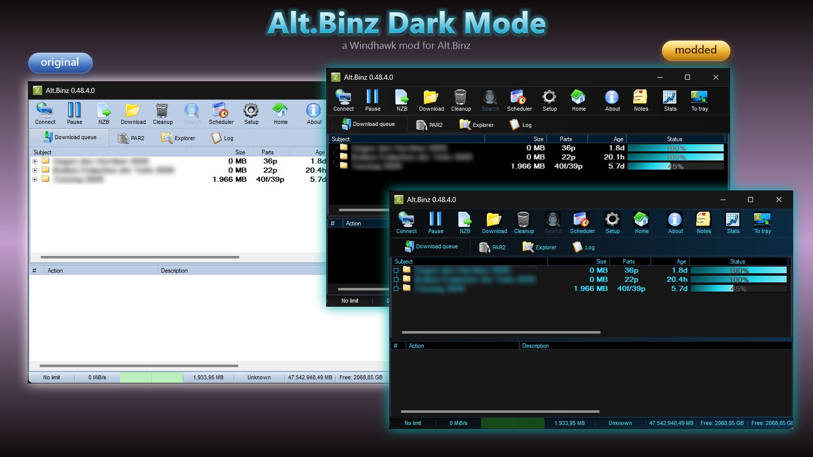

# Alt.Binz Dark Mode

A [Windhawk](https://windhawk.net) mod that turns the light blue skin of [Alt.Binz](https://www.altbinz.net) into a dark theme, with optional colors, gradients and colored progress bars.

## Why

Alt.Binz draws its whole user interface from a light blue skin (it is a Delphi program with a BusinessSkinForm skin), so it ignores the Windows dark mode. This mod re-colors everything the program draws with GDI: brushes, pens, text colors, system colors and the skin bitmaps. It also switches the standard Windows controls (scroll bars, the Open file dialog, shell menus) to their own dark look.

Only `altbinz.exe` is affected. No skin files are changed. Disabling the mod brings the original look back; restart Alt.Binz afterwards to get it completely.

## Install

1. Install [Windhawk](https://windhawk.net).
2. Open Windhawk and click **Create a new mod** (bottom right).
3. Replace the whole content of the editor with the contents of [`altbinz-dark.wh.cpp`](altbinz-dark.wh.cpp) from this repository.
4. Click **Compile Mod**. Alt.Binz picks the mod up when it starts; restart it if it is already running.

Once the mod is available in the Windhawk catalog, you can install it from there with one click.

## Settings

All colors are hex codes, for example `2F5A96` or `#2F5A96`. A value that cannot be read is ignored.

| Group | Setting | Default | Applies |
| --- | --- | --- | --- |
| Surface | Surface color | empty (original blue) | live |
| Gradient | Use a gradient, start / end color, balance, angle | off, `2F5A96` / `152238`, 50, 90 | live |
| Progress bars | Color, gradient color, direction (top to bottom or left to right) | empty (blue) | live |
| Appearance | Background lightness, text lightness, saturation | 11 / 92 / 85 | restart Alt.Binz |
| Appearance | List background color | empty | restart Alt.Binz |
| Appearance | Column header color | empty (blue) | live |
| Appearance | Text color (interface; the text lightness is ignored when it is set) | empty | live |
| Appearance | List text color (download queue and log) | empty (text color) | live |
| Appearance | Column text color (text of the column headers) | empty (text color) | live |
| Appearance | Title bar color (Windows 11) | `000000` | live |
| Appearance | Keep the tree in Setup dark gray | off | live |

Bright surface colors are darkened automatically so that the light text stays readable.

## Compatibility

Tested with Alt.Binz 0.48.4 (32-bit) on Windows 11 (build 26100). Other versions may work but have not been tested. Skins other than the default blue one are not supported.

## License

[MIT](LICENSE)
